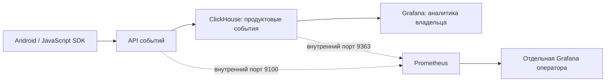

# Мониторинг сервиса

Локальная версия **0.10.1**. Продуктовые события остаются в ClickHouse. Prometheus собирает технические показатели; отдельная Grafana оператора показывает состояние сервиса. Эти данные не добавлены в панели клиентов.



## Запустить из исходников

Нужен только работающий Docker с Compose. Выполняйте команды в корне репозитория. Не добавляйте `docker-compose.release.yml`: он выбирает опубликованную версию 0.9.0. Новый запуск собирает 0.10.1 локально, не публикует образы.

Один раз создайте случайные пароли; повтор команды сохраняет существующие значения:

```powershell
docker run --rm --user 0 --mount "type=bind,source=$($PWD.Path),target=/workspace" -w /workspace node:24.22.2-bookworm-slim node scripts/init-monitoring.mjs
```

В Linux/macOS эквивалентная команда:

```bash
docker run --rm --user 0 --mount "type=bind,source=$PWD,target=/workspace" -w /workspace node:24.22.2-bookworm-slim node scripts/init-monitoring.mjs
```

Запуск, проверка состояния и остановка с сохранением данных:

```bash
docker compose -f docker-compose.yml -f docker-compose.monitoring.yml up -d --build --wait
docker compose -f docker-compose.yml -f docker-compose.monitoring.yml ps
docker compose -f docker-compose.yml -f docker-compose.monitoring.yml down
```

Для существующего стенда сначала сохраните резервные копии `appdata` и `dbdata` при остановленных сервисах. Compose использует те же тома аккаунтов и событий, обновляя ClickHouse внутри ветки 26.8 LTS. Для Grafana 13 создаётся новый том `product_grafana_13`: клиентские панели восстанавливаются из настроек кабинета при открытии, личные настройки старой Grafana не переносятся. Старый `grafanadata` сохраняется. Не используйте `down -v`.

| Что открыть | Адрес | Доступ |
|---|---|---|
| Кабинет и продуктовая аналитика | http://localhost:8080 | Прежний аккаунт кабинета |
| Мониторинг оператора | http://localhost:3100/d/ulsa-service | Логин `operator`, пароль из файла ниже |
| Prometheus: цели и правила | http://localhost:9091/targets и http://localhost:9091/alerts | Только локальный компьютер, отдельного входа нет |

Если порт занят, задайте `PROMETHEUS_PORT` или `MONITORING_PORT` в локальном `.env` (например, `PROMETHEUS_PORT=9092`) и повторите запуск. Внутренние адреса контейнеров при этом остаются прежними. На этом компьютере 9090 уже использовался другим процессом, поэтому внешний порт по умолчанию выбран 9091.

Пароль оператора находится в `.monitoring-secrets/operator-password`. Откройте этот файл локально, например `Get-Content .monitoring-secrets/operator-password` в PowerShell. Не отправляйте его в чат, Git или отчёт. Второй файл `dashboard-password` предназначен для связи сервера с продуктовой Grafana; вводить его в клиентском кабинете не нужно.

Файлы игнорируются Git и не попадают в образ приложения. На Linux права файлов — `0440`, владелец root и служебная группа 65530, каталог — `0700`. Только нужным контейнерам добавлена эта группа и соответствующий secret. На Windows дополнительно действуют ACL хоста: Linux-режим внутри Docker не заменяет ограничение доступа к папке Windows.

Grafana применяет начальный пароль только при создании своей БД. Изменение файла не меняет пароль в уже существующем томе. При восстановлении используйте исходный файл либо выполняйте согласованную ротацию одновременно в Grafana и файле; удалять том с данными для смены пароля не нужно.

## Что показывают графики

- Доступность API, чтения ClickHouse и продуктовой Grafana; число операций, ожидающих/выполняющих запись в процессе API.
- Запросы в секунду, p95 длительности ответа (без healthcheck и Grafana) и скорость ответов HTTP 4xx/5xx. Правило тревоги отдельно считает долю 5xx.
- CPU, RSS, event loop и память процесса Node.js. Это не общий расход RAM компьютера или всех контейнеров.
- Принятые новые события и подтверждённые повторы отдельно; отклонённые пакеты не увеличивают число сохранённых событий.
- RSS, отслеживаемая память, скорость запросов и число активных запросов ClickHouse; память самого Prometheus.

Названия маршрутов — ограниченный набор шаблонов (`/console/apps/:appId/stats`), без реальных appId, URL-параметров, ключей, email и текстов событий. Идентификаторы сессий, моделей и пользователей не используются как метки. Метрики API сбрасываются при перезапуске процесса: графики используют `rate()`, а не принимают накопительный счётчик за вечную статистику. Долговечной очереди сообщений пока нет; показатель pending — очередь текущего процесса, а не брокера.

Сбор выполняется каждые 15 секунд. Prometheus хранит блоки до 7 дней или примерно 512 МБ; это настройка retention, не жёсткая квота всего тома: WAL и служебные данные требуют дополнительного места. Интерфейс использует часовой пояс браузера.

## Сеть и права

Порты метрик 9100/9363 не опубликованы на хост. Публичный сервер на 8080/3000 не обслуживает `/metrics`. У клиентов нет источника Prometheus и членства в операторской Grafana. Ограниченный пользователь ClickHouse и политика строк проверяются самой БД, в том числе когда SQL отправлен без фильтра панели.

Порты 9091 и 3100 привязаны к **127.0.0.1**, поэтому телефон и другие компьютеры не откроют их по LAN-адресу. Prometheus доступен локальным процессам без пароля; это не граница защиты от других пользователей самого компьютера. Для удалённого мониторинга используйте контролируемый SSH/VPN-туннель или отдельный шлюз с аутентификацией. Не заменяйте привязку на `0.0.0.0` без такой защиты.

Продуктовые порты 8080/3000 сохранены для существующей локальной демонстрации и телефона. Сам стенд остаётся локальным HTTP-окружением с демонстрационными реквизитами ClickHouse. [Условия публичного размещения и аудит](SECURITY_AUDIT_2026-11-01.md).

## Тревоги

В Prometheus настроены `UlsaApiDown`, `UlsaStorageUnavailable`, `UlsaDashboardUnavailable` (ожидание 1 минута) и `UlsaHighServerErrorRate` (5 минут). Состояния видны в `/alerts`. Alertmanager и отправка сообщений в Telegram/почту пока **не подключены**. Остановка API и БД с переходом в firing и последующим снятием тревог проверена в отдельном тестовом окружении.

## Проверить изменения

Автоматические проверки создают тестовые аккаунты и события, поэтому выполняются только в отдельном проекте `ulsa-security-audit`:

```bash
docker compose -p ulsa-security-audit -f docker-compose.yml -f docker-compose.monitoring.yml -f docker-compose.audit.yml up -d --build --wait app dashboard prometheus monitoring-dashboard
docker compose -p ulsa-security-audit -f docker-compose.yml -f docker-compose.monitoring.yml -f docker-compose.audit.yml run --rm --build checks
docker compose -p ulsa-security-audit -f docker-compose.yml -f docker-compose.monitoring.yml -f docker-compose.audit.yml down
```

Его порты: 18085/13000 для продукта, 19090 для Prometheus и 13100 для оператора. При ручной проверке дождитесь `up=1` для трёх целей и откройте панель оператора. Отдельно убедитесь, что без входа `/api/search` операторской Grafana возвращает 401, а `/metrics` на продуктовом порту — 404. Не останавливайте пользовательскую БД ради испытания отказов.

Проверка конфигурации:

```bash
docker compose -f docker-compose.yml -f docker-compose.monitoring.yml exec prometheus promtool check config /etc/prometheus/prometheus.yml
docker compose -f docker-compose.yml -f docker-compose.monitoring.yml exec prometheus promtool check rules /etc/prometheus/alerts.yml
```

Grafana собирается из официального `13.3.0-slim` с подписанным Prometheus-плагином из стандартного образа той же версии. Остальные встроенные backend-плагины не нужны; ClickHouse 4.23.4 поставляется отдельно с проверкой SHA-256 для amd64/arm64. Это не изменение исходного кода Grafana. Перед обновлениями повторяйте тесты и сканирование зависимостей: фиксированные версии не гарантируют отсутствие новых CVE.

## Список ручной проверки

- [ ] Открыть кабинет на 8080: прежние проекты и приложения на месте, статистика за весь период показывает прежние события.
- [ ] Открыть 3100: требуется отдельный вход `operator`; после входа доступны графики состояния сервиса.
- [ ] В 9091/targets три цели имеют состояние UP; API, БД и продуктовая Grafana отмечены доступными в панели.
- [ ] После отправки событий из своего SDK растёт показатель accepted; счётчик duplicate отображается отдельно. Значения Prometheus не являются числом уникальных пользователей.
- [ ] У обычного владельца в продуктовой Grafana нет источника `ulsa-monitoring`; чужой идентификатор приложения не открывает его статистику.
- [ ] На 8080/metrics ответ 404; без отдельной сессии оператора 3100/api/search отвечает 401. Телефон по LAN-адресу компьютера не получает доступ к 9091/3100.
- [ ] После остановки/повторного запуска Compose без `-v` аккаунты, события и история Prometheus сохраняются. Счётчики процесса API начинают новый отсчёт.

Остановки API/БД ради проверки тревог выполняйте только в отдельном тестовом проекте. Полный автоматический прогон и оба сценария отказа уже выполнены при разработке этой версии.

Проверка физического телефона: [TECNO, SDK и Prometheus — 01.11.2026](PROMETHEUS_DEVICE_QA_2026-11-01.md).
